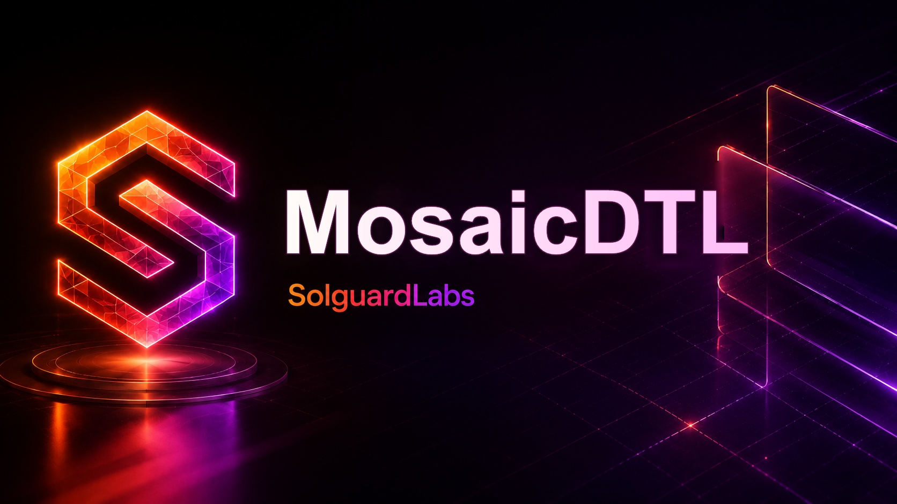

# MosaicDTL

MosaicDTL es un laboratorio CTF escrito en C++17 que modela un protocolo de
fragmentacion de liquidez. Cada boveda divide sus fondos en piezas asignadas a
rutas, operadores y prioridades. La CLI ejecuta escenarios deterministas y
devuelve JSON estable para tests TypeScript.

## Componentes

- \`src/ledger.*\`: bovedas, fragmentos, reservas, retiradas y cierre de rutas.
- \`src/consolidator.*\`: planificador de consolidacion de fragmentos.
- \`src/audit.*\`: reconciliacion nominal y backing economico de obligaciones.
- \`src/scenarios.*\`: escenarios publicos y fixture de investigacion.
- \`src/policy_catalog._\` y \`src/risk_matrix._\`: catalogos de politica usados
  para simular una superficie de protocolo realista.
- \`tests/node/*.test.ts\`: tests de contrato TypeScript ejecutados por Node.

## Requisitos

- Node.js 20 o superior.
- Un compilador C++17 disponible como \`CXX\`, \`c++\`, \`g++\` o \`clang++\`.

En Windows, el script de build tambien busca instalaciones locales de LLVM en
\`AppData\\Local\\Programs\`.

## Uso

Compilar:

\`\`\`bash
npm run build
\`\`\`

Listar escenarios:

\`\`\`bash
build/mosaicdtl list
\`\`\`

Ejecutar un escenario:

\`\`\`bash
build/mosaicdtl scenario allocation
build/mosaicdtl scenario consolidation
build/mosaicdtl scenario provenance-leak
\`\`\`

Ejecutar tests:

\`\`\`bash
npm test
\`\`\`

## Estado Del Lab

El proyecto esta preparado como repositorio de auditoria autocontenido. Los
tests publicos validan asignacion, retirada, consolidacion y cierre de rutas,
mientras que el reto esta en razonar sobre la procedencia economica de los
fragmentos consolidados.
