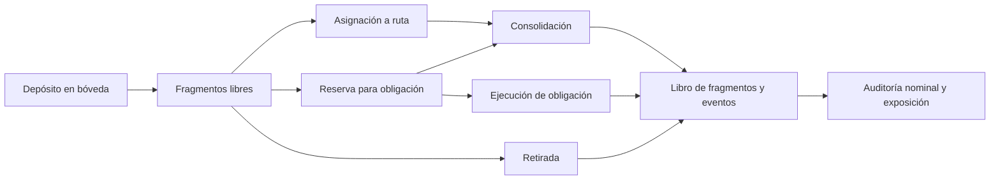

# MosaicDTL


MosaicDTL es un motor de contabilidad de liquidez fragmentada para coordinar bóvedas, rutas operativas y obligaciones de pago. Cada transformación deja un fragmento descendiente y un evento ordenado; el estado se puede reconstruir sin una base de datos ni servicios de red. La distribución `1.0.0` ofrece una CLI determinista y un contrato JSON para integraciones y revisión financiera.

## Arquitectura



| Componente          | Responsabilidad                                                        |
| ------------------- | ---------------------------------------------------------------------- |
| `Ledger`            | Altas, depósitos, asignaciones, reservas, ejecución y cierre de rutas. |
| `ConsolidationPlan` | Selección de fragmentos y emisión de un recibo trazable.               |
| `AuditReport`       | Reconciliación de depósitos, salidas y obligaciones abiertas.          |
| `ExposureBook`      | Capacidad, liquidez comprometida y holgura por ruta.                   |
| CLI y JSON          | Escenarios reproducibles para consumidores sin dependencias de red.    |

## Modelo económico

Los importes son enteros en la unidad mínima definida por la integración. No hay conversión implícita de divisas ni decimales de coma flotante. Para una bóveda, la reconciliación nominal es:

```text
depositado = libre_activo + reservado_activo + retirado + ejecutado
holgura_ruta = max(0, capacidad_ruta - activo_en_ruta)
```

El primer balance cuenta estados actuales, no fragmentos históricos ya consolidados. La holgura es una métrica de exposición para planificación y no una autorización de operación. La auditoría también compara obligaciones abiertas con el respaldo activo asociado. Consulte el [modelo económico](docs/ECONOMICS.md) para un ejemplo numérico.

## Inicio rápido

Requisitos: Node.js 22+, un compilador C++17 (`g++`, `clang++` o `c++`) y Bash para los scripts de CI. En Windows, use WSL o configure `CXX` con un compilador compatible.

```bash
npm install
npm run build
./build/mosaicdtl list
./build/mosaicdtl scenario allocation
npm test
bash scripts/ci.sh
```

En Windows nativo, el ejecutable se llama `build/mosaicdtl.exe`. El comando `list` muestra los escenarios disponibles. Cada `scenario` produce un único documento JSON en stdout; los errores operativos se escriben en stderr y devuelven un código distinto de cero.

Ejemplo de lectura de exposición tras una asignación:

```json
{
  "metrics": {
    "route_north": 430000,
    "route_south": 220000,
    "unallocated_free": 350000,
    "largest_route": 430000,
    "route_headroom": 4450000,
    "route_active_total": 650000,
    "route_committed_total": 300000,
    "active_routes": 2
  },
  "flags": { "routes_within_capacity": true }
}
```

Los campos mostrados son un extracto del documento completo, no una respuesta independiente. [Integración](docs/INTEGRATION.md) describe el formato y sus límites.

## Calidad y compatibilidad

`npm test` compila la CLI y ejecuta contratos TypeScript sobre sus salidas. El flujo de CI añade comprobación sintáctica y formato de los artefactos de texto. Los escenarios son deterministas para una misma versión; los consumidores deben ignorar campos JSON adicionales que aparezcan en versiones compatibles.

La rama `production` y el tag `v1.0.0` identifican el mismo código de esta entrega. Se trata de un motor local de referencia; cualquier integración con custodia, redes o activos externos requiere revisión y controles propios.

Documentación: [arquitectura](docs/ARCHITECTURE.md), [modelo económico](docs/ECONOMICS.md), [operación](docs/OPERATIONS.md), [integración](docs/INTEGRATION.md) y [política de seguridad](SECURITY.md).
