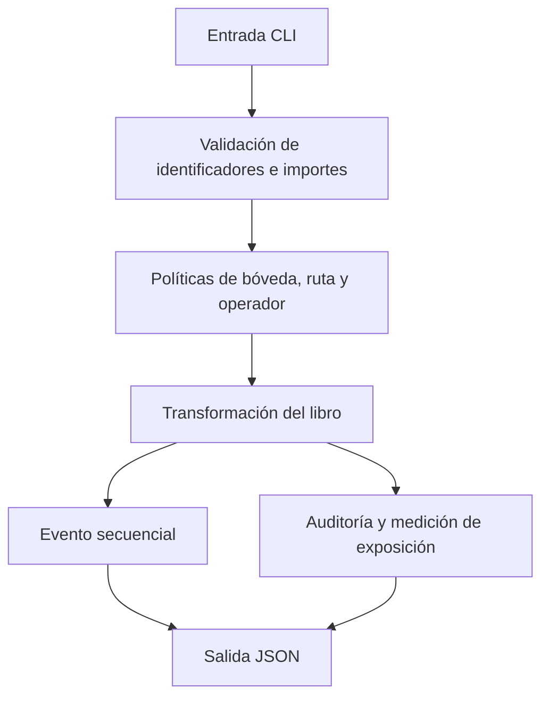

# Política de seguridad de MosaicDTL

## Modelo de confianza

La CLI procesa escenarios locales y no acepta peticiones de red. Una bóveda agrupa saldo de un propietario; las rutas pertenecen a operadores registrados; las obligaciones identifican importes comprometidos. Las entradas de identificador y los importes se validan antes de modificar el libro. El JSON de salida es una representación de estado y no debe usarse como fuente de autorización fuera del proceso que lo generó.

## Propiedades sometidas a revisión

- La suma de saldos activos y salidas terminales debe conciliar con los depósitos, sin sumar dos veces fragmentos históricos.
- Las transiciones de fragmentos mantienen identificadores de progenitores, generaciones y un diario ordenado.
- Una obligación abierta se revisa frente a su saldo reservado activo.
- La exposición muestra capacidad, activo y holgura de cada ruta; la holgura no sustituye las verificaciones de autorización.
- Los cálculos de suma y resta monetaria usan operaciones comprobadas cuando cambia un saldo contable.

Estas propiedades son objetivos de revisión, no una certificación ni una garantía de ausencia de defectos.

## Validación y dependencias

El pipeline ejecuta `bash scripts/ci.sh` en cada push y pull request. Comprueba la sintaxis de scripts, el formato y los contratos de la CLI. Dependabot revisa las dependencias npm y GitHub Actions semanalmente. La revisión de cambios en el motor C++ debe incluir flujos nominales, límites de importe, transiciones de estado y compatibilidad del JSON.

## Comunicación de incidencias

No publique detalles sensibles en una issue. Utilice el mecanismo de reporte privado de seguridad de GitHub del repositorio, si está habilitado. Incluya versión/commit, precondiciones, secuencia mínima reproducible, resultado observado y resultado esperado, sin adjuntar datos de terceros. Las incidencias de documentación o integración que no sean sensibles pueden abrirse como issues ordinarias.
