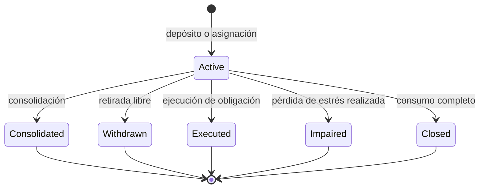

# Arquitectura y ciclo de vida

MosaicDTL separa el libro de estado (`Ledger`), el cálculo de transformaciones (`ConsolidationPlan`), la cotización de margen (`MarginQuote`), la reconciliación (`AuditReport`), las vistas de exposición (`ExposureBook`) y la serialización JSON. La CLI compone estos componentes en escenarios deterministas; ningún módulo requiere un servicio externo.

Cada fragmento conserva `id`, bóveda, ruta, operador, clase económica, importe, prioridad, generación y padres. Los estados terminales sirven para auditoría; solo `Active` entra en la exposición corriente. El libro registra eventos secuenciales y un recibo por consolidación con padres, salidas e importes. Una mezcla de liquidez libre y reservas produce salidas distintas; cada obligación conserva su propio identificador.

## Fronteras de operación

1. El depósito incorpora saldo libre a una bóveda existente.
2. La asignación mueve saldo libre a una ruta y operador registrados.
3. La reserva vincula saldo a una obligación identificada.
4. La consolidación crea una salida por clase económica y obligación a partir de los fragmentos seleccionados, y marca los padres como históricos.
5. El margen adicional se vincula a una obligación sin aumentar su principal. La cotización agrega exposición por ruta y limita la liberación de excedente.
6. Un evento de estrés para un operador registra el deterioro realizado de sus rutas, sin volver a aplicarlo dos veces al mismo compromiso y operador.
7. La retirada consume únicamente fragmentos clasificados como libres; la ejecución de obligación consume fragmentos reservados para su identificador.
8. El cierre de ruta requiere que no queden fragmentos activos en ella.

Las vistas de auditoría y exposición son lecturas posteriores a la transición. Su salida resulta útil para reconciliación y supervisión, pero no reemplaza la validación de entrada de cada operación.
