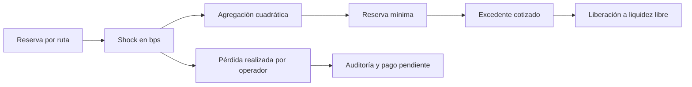

# Modelo económico y exposición

Los importes se contabilizan en unidades mínimas enteras. Se distinguen saldo libre, saldo reservado para obligaciones, retiradas y ejecuciones. Un fragmento histórico consolidado demuestra procedencia, pero no añade saldo disponible.

```text
D = F + R + W + E + I
H(r) = max(0, C(r) - A(r))
A(r) = F(r) + R(r)
```

`D` es el total depositado; `F` y `R`, los saldos activos libre y reservado; `W`, `E` e `I`, retiradas, ejecuciones y pérdidas realizadas terminales. `C(r)` es la capacidad declarada de la ruta, `A(r)` su saldo activo y `H(r)` su holgura observada. Si `A(r) > C(r)`, la vista registra holgura cero y `within_capacity = false`. No se permite que una resta sin signo represente una holgura negativa.

## Margen de una obligación

Una obligación puede distribuir su principal reservado entre varias rutas y
añadir margen sin aumentar el importe del pago prometido. Para cada ruta se
calcula una pérdida de estrés entera. La cotización agrega los cuadrados,
redondea la raíz hacia arriba y exige principal más estrés modelado:

```text
loss[r] = floor(reserved[r] * stressBps[r] / 10_000)
modeledStress = ceil(sqrt(sum(loss[r]^2)))
minimumReserve = principalPending + modeledStress
releasable = max(0, reservedTotal - minimumReserve)
```

El escenario `margin` reserva 200.000 unidades de principal en cada una de
dos rutas y añade 125.000 de margen a cada ruta. Con `stressBps = 3.000`,
ambas rutas muestran 97.500 de pérdida cotizada; la raíz de su suma de
cuadrados se redondea a 137.886. La reserva total de 650.000 y el principal
de 400.000 dejan un excedente cotizado de 112.114. El escenario libera 50.000,
realiza 82.500 de pérdida en una ruta y paga las 400.000 unidades de la
obligación. El informe conserva el deterioro como salida terminal y concilia
el depósito inicial completo.



## Ejemplo reproducible

En `allocation`, la bóveda recibe 1.000.000 unidades. Se reservan 180.000 y 120.000 unidades para dos obligaciones; 250.000 y 100.000 se asignan como liquidez operativa a las dos rutas. Quedan 350.000 sin asignar. Por tanto:

```text
reservado activo = 300.000
libre activo = 700.000 = 350.000 asignado + 350.000 sin asignar
activo route-north = 430.000
activo route-south = 220.000
mayor exposición a una ruta = 430.000
```

Las cuatro rutas registradas suman 5.100.000 unidades de capacidad; el activo en rutas suma 650.000. La holgura agregada es 4.450.000. Este dato no equivale a liquidez disponible para retirar: una capacidad vacía no representa fondos depositados. El riesgo de concentración se lee comparando `largest_route` con `route_active_total`, no con la suma de capacidades.

## Control operativo

La reconciliación nominal detecta creación o pérdida de importe. La revisión de obligaciones examina además saldos vinculados a compromisos abiertos. La medición de exposición informa de concentración y presión de capacidad. Son controles complementarios: cada uno responde a una pregunta económica distinta.
