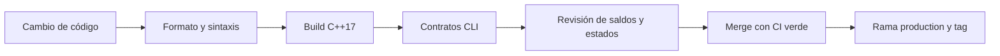

# Operación y cambios

## Desarrollo local

```bash
npm install
npm run build
npm test
bash scripts/ci.sh
```

La compilación usa `CXX` si está definido; en su defecto busca un compilador C++17 local. Los binarios se escriben en `build/` y las transpilaciones de test en `.test-build/`; ambos directorios se ignoran en Git. `npm run fmt:check` verifica JSON, Markdown, YAML y scripts JavaScript/TypeScript.

## Secuencia de revisión



Antes de publicar un cambio económico, compare el comportamiento de depósitos, reservas, asignaciones, consolidaciones, retiradas y cierres de ruta. Revise los recibos junto al historial de fragmentos y compruebe que los consumidores JSON aceptan campos nuevos. Un cambio de formato o semántica que rompa consumidores exige versión mayor.

El flujo `release-integrity` vuelve a ejecutar CI cuando se publica el tag y el release. También exige que `main`, `production` y el tag anotado resuelvan al mismo commit.

## Diagnóstico

- Si falla la compilación, verifique `CXX`, la versión C++17 y la salida del compilador; no confunda un error de toolchain con un fallo contable.
- Si una ruta no puede cerrarse, consulte el activo por ruta y los fragmentos en estado `Active` antes de repetir la operación.
- Si una obligación no se ejecuta, contraste importe pendiente, saldo reservado activo y eventos `execution_blocked`.
- Si una suma nominal no concilia, excluya los fragmentos históricos marcados como consolidados y confirme la escala entera del activo.
